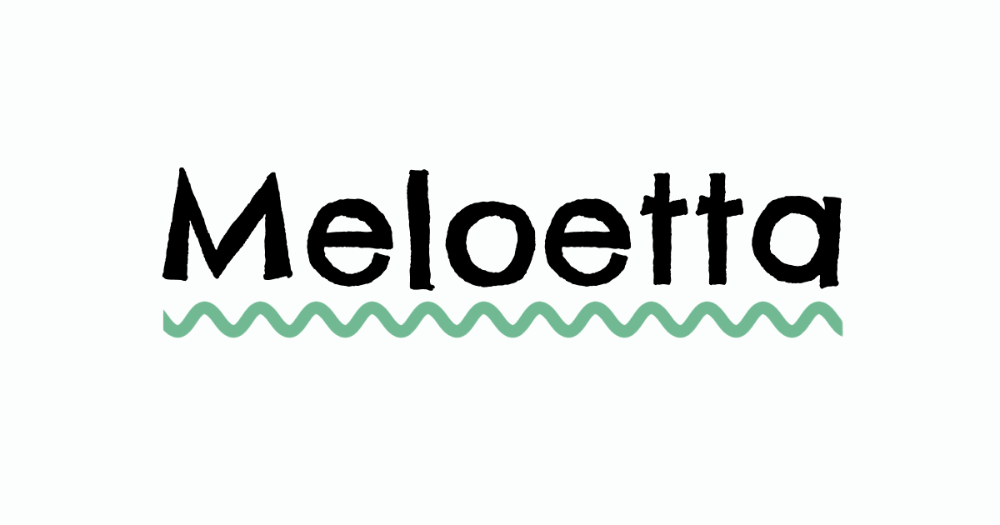

# Meloetta

A simple music note-reading game. A note appears on the staff, and you name it as fast as you can.

- Practice in **treble** or **bass** clef
- Choose your range: full range, notes on the staff, ledger lines above or below, or beginner-friendly lines-only and spaces-only
- Earn XP for every correct answer, and one wrong answer ends your run
- Beat your best score for each clef and range
